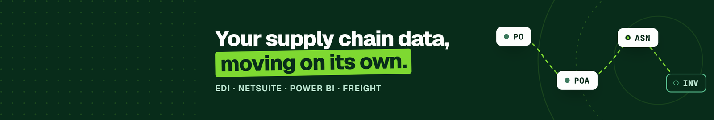
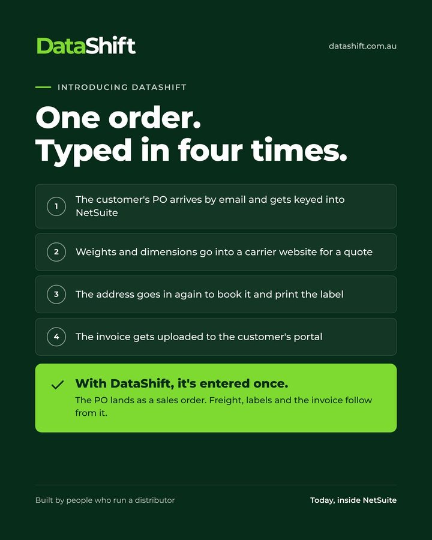
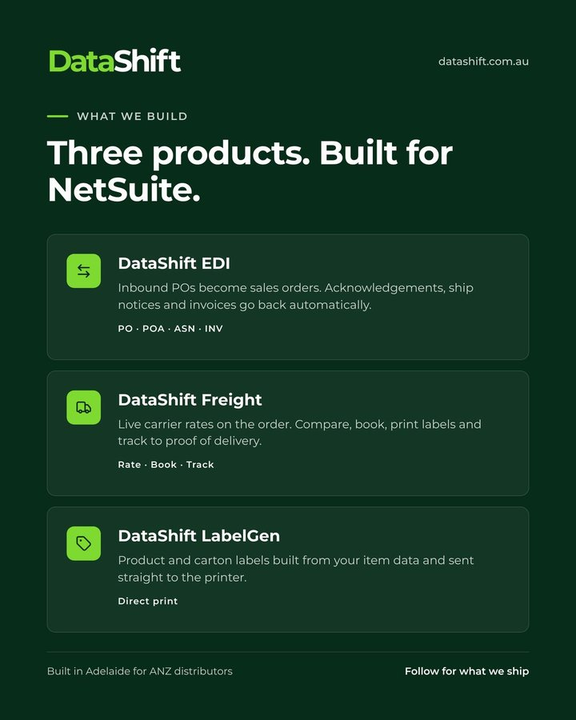

  <picture>
    <source media="(prefers-color-scheme: dark)" srcset="assets/logo-ondark.png">
    
  </picture>

  

<h3 align="center">Your supply chain data, moving on its own.</h3>

  Software for distributors. Built in Adelaide for ANZ distributors. Today, inside NetSuite. 
  <a href="https://datashift.com.au">datashift.com.au</a> · <a href="mailto:support@datashift.com.au">support@datashift.com.au</a>

---

### One order. Typed in four times.

The customer's PO arrives by email and gets keyed into NetSuite. Weights and dimensions go into a carrier website for a quote. The address goes in again to book it and print the label. Then the invoice gets uploaded to the customer's portal.

**With DataShift, it's entered once.** The PO lands as a sales order. Freight, labels and the invoice follow from it.

### Three products. Built for NetSuite.

| | |
|---|---|
| <picture><source media="(prefers-color-scheme: dark)" srcset="assets/product-edi-ondark.svg"></picture> | **Inbound POs become sales orders.** Acknowledgements, ship notices and invoices go back automatically.  PO · POA · ASN · INV |
| <picture><source media="(prefers-color-scheme: dark)" srcset="assets/product-freight-ondark.svg"></picture> | **Live carrier rates on the order.** Compare, book, print labels and track to proof of delivery.  Rate · Book · Track |
| <picture><source media="(prefers-color-scheme: dark)" srcset="assets/product-labelgen-ondark.svg"></picture> | **Product and carton labels built from your item data** and sent straight to the printer.  Direct print |

Each works on its own, and they share the same data.

  
  &nbsp;
  

### Built by people who run a distributor

Every DataShift product started as a problem we ran into ourselves. That keeps it practical: it has to work on a Monday morning with a full order queue.

**Talk to us:** [datashift.com.au](https://datashift.com.au) · [support@datashift.com.au](mailto:support@datashift.com.au)

DataShift Pty Ltd · Adelaide, South Australia
